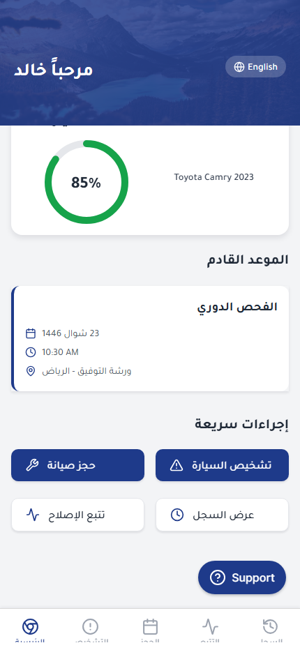

# Sallehni

A React Native/Expo vehicle-service prototype with Arabic/English interface controls, right-to-left layouts and a browser-runnable demo.

## Try it

- [Open the browser demo](https://hwq12331.github.io/Sallehni/)
- [View the source](https://github.com/hwq12331/Sallehni)



## Features

- Five main screens: vehicle-health overview, diagnostics, service booking, repair tracking and service history.
- Arabic-first interface with English navigation/label support and RTL-aware components.
- Simulated vehicle diagnostics with issue cards, urgency levels and estimated repair costs.
- Booking interface with selectable dates/time slots and sample garage listings.
- Repair-progress and maintenance-history views using sample records.
- Hijri/Gregorian calendar controls and a support screen.
- Reusable cards, header, health gauge and service-status components.

This is an interactive frontend prototype. Diagnostics, tracking, garage listings and service history use sample data; garage selection, some filters and detail/support actions are placeholders. The app does not connect to vehicle hardware or submit real repair bookings. Some sample content remains Arabic when the interface is switched to English.

## Technology

React Native 0.76 · Expo SDK 52 · Expo Router · TypeScript · React Native Web · React Context · Inter/Tajawal fonts · Lucide icons

## Run locally

Requirements: Node.js 22 and npm.

```sh
git clone https://github.com/hwq12331/Sallehni.git
cd Sallehni
npm ci
npm run dev:web
```

Open the browser URL printed by Expo, normally **http://localhost:8081**. No account, environment file or API key is required. These commands work in Windows PowerShell, macOS and Linux.

### Build and verify

```sh
npm run typecheck
npm run build:web
```

The browser export is generated in `dist/`. Metro is limited to two workers to keep builds reliable on typical developer machines.

### Native development

`npm run dev` starts the Expo development server. The native project uses Expo SDK 52 and requires a compatible Expo client/development build. The published portfolio demo runs in a browser.

### Static-host subdirectory support

`app.config.js` accepts `EXPO_BASE_URL` at build time. For example, the GitHub Pages export uses `/Sallehni` as its base path. Ordinary local development uses the site root.

## Project structure

```text
app/
  (tabs)/         Five main screens and tab navigation
  support.tsx     Support interface
components/       Reusable vehicle/service UI components
contexts/         Localization, RTL and calendar state
hooks/            Translation and platform-safe framework hooks
locales/          Arabic and English interface strings
constants/        Shared colors
```

## Portfolio context

Created by **Hussain Alqassab**. This project demonstrates mobile-style UI development, localization, reusable components and service-workflow prototyping.

[GitHub profile](https://github.com/hwq12331) · [LinkedIn](https://www.linkedin.com/in/hussain-alqassab-0356b83b2/)
